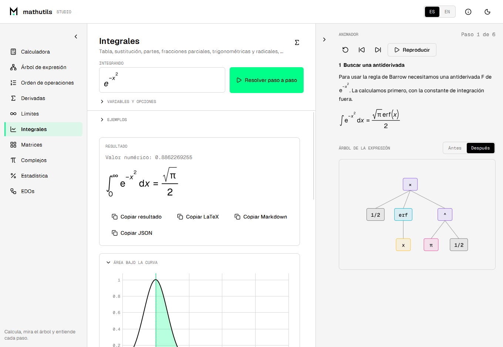
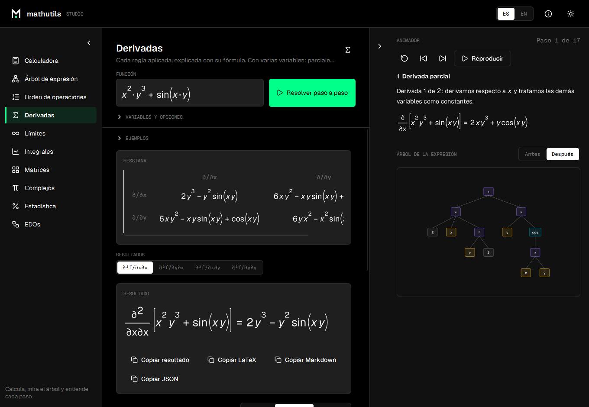

# MathUtils Studio

> **Una aplicación de escritorio para matemáticas paso a paso**: derivadas, límites e integrales explicadas regla por regla, con
> el árbol de expresión de cada paso, y paneles de matrices, complejos, estadística y ecuaciones diferenciales. Funciona en
> Windows y Linux.

> **English documentation**: [README.md](README.md)

<p align="center">
  
  
</p>

## Qué hace

- **Calculadora** con resultado exacto y decimal, variables, funciones propias e historial.
- **Derivadas, límites e integrales, paso a paso.** Cada paso nombra la regla, muestra su fórmula con los valores del problema y
  el resultado parcial. Las integrales cubren sustitución, partes, fracciones parciales, formas trigonométricas y con
  radicales, funciones especiales (`erf`, `Si`, `Ci`, `Ei`, `li`) e integrales definidas e impropias. Los resultados se
  verifican, y cuando el motor no sabe resolver algo lo dice en vez de adivinar.
- **Varias variables:** derivadas parciales mixtas, gradiente, hessiana, jacobiana, divergencia, laplaciano, integrales iteradas
  y límites en un punto (demuestra que un límite no existe, o demuestra su valor, y si no solo ofrece un candidato).
- **Vista previa en tiempo real** de lo que escribes, con la notación matemática correcta, y una **paleta de símbolos** para lo
  que el teclado no tiene (`π`, `√`, `x²`, `∞`, letras griegas).
- **Animador** en un panel lateral plegable: recorre los pasos y dibuja el árbol de la expresión antes y después de cada uno.
  Los pasos se muestran en tres niveles de detalle (resumen, principal, completo).
- **Árbol de expresión** y **orden de operaciones**, animados.
- **Paneles** de matrices (inversa, LU, sistemas lineales), complejos (plano de Argand, raíces), estadística (resumen,
  histograma, distribuciones) y ecuaciones diferenciales (Euler, Heun, RK4, Dormand-Prince, con gráfica).
- Español e inglés, temas claro y oscuro.

## Descarga

Descarga el instalador para Windows (`MathUtilsStudio-*-windows-x64-setup.exe`) o el paquete de tu Linux desde las
[releases](https://github.com/blacknoize404/MathUtils-Studio/releases):

| Distribución | Paquete |
|---|---|
| Debian, Ubuntu y derivadas | `.deb` (`sudo apt install ./mathutilsstudio_*.deb`) |
| Fedora, openSUSE | `.rpm` (`sudo dnf install ./mathutilsstudio-*.rpm`) |
| Arch Linux y derivadas | `mathutils-studio-*.pkg.tar.zst` (`sudo pacman -U`), o construye el [PKGBUILD](packaging/arch/PKGBUILD) |
| NixOS y Nix | el flake, mira [más abajo](#nixos-y-nix) |
| Cualquier otra | `.tar.gz`, con un `install.sh` que la instala para tu usuario sin permisos de administrador |

Todos los paquetes traen su propio runtime de Java.

## NixOS y Nix

El repositorio es un flake que empaqueta la versión de Linux (la aplicación trae su propio runtime de Java):

```bash
nix run github:blacknoize404/MathUtils-Studio
```

Para instalarla en NixOS, añade el flake como entrada y el overlay a tu configuración:

```nix
{
  inputs.mathutils-studio.url = "github:blacknoize404/MathUtils-Studio";

  # en tu configuración
  nixpkgs.overlays = [ inputs.mathutils-studio.overlays.default ];
  environment.systemPackages = [ pkgs.mathutils-studio ];
}
```

El paquete no es software libre, así que Nix pide permitirlo. `nix run` ya lo permite para este paquete; en NixOS añade
`nixpkgs.config.allowUnfreePredicate = pkg: lib.getName pkg == "mathutils-studio";` junto al overlay. El paquete
(`nix/package.nix`) apunta a la última release publicada.

## Agradecimientos

A mi profesor de Matemática Continua de la Universidad de Holguín, Alberto, y a mi tutora, Yisel Clavel Quintero, por su apoyo incondicional.

## Créditos y licencia

Creada por [barnesinside](https://barnesinside.is-a.dev). El motor es la librería [BI.MathUtils](https://github.com/blacknoize404/BI.MathUtils), del mismo autor. Tipografías Geist y Geist Mono
(SIL Open Font License) e iconos Lucide (licencia ISC). La aplicación es de uso gratuito bajo el [acuerdo de licencia](LICENSE); su código fuente es privado. [NOTICE.md](NOTICE.md) detalla qué cubre cada una.
